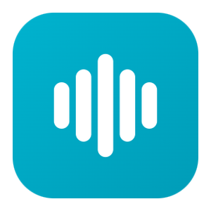
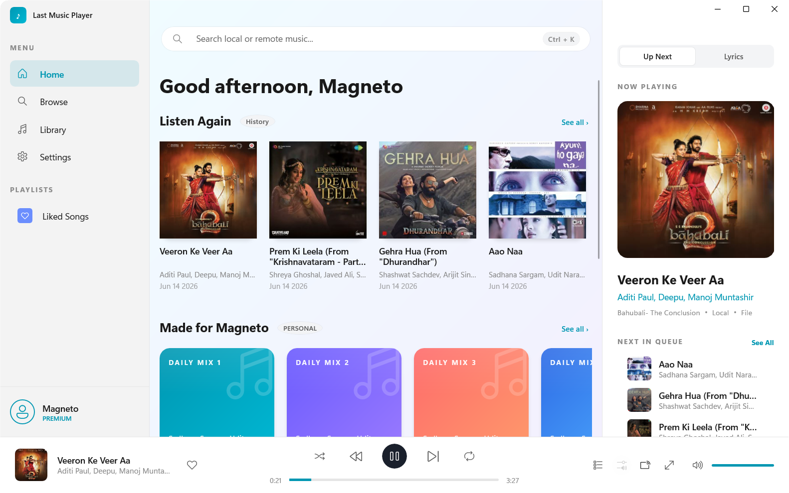

<div align="center">
  

  <h1>Last Music Player</h1>

  <p>
    <strong>A fast native Windows music player for the music on your PC, with optional remote playback through your own server or a build-configured account service.</strong>
  </p>

  <p>
    Offline playback comes first. Remote features stay behind either a private build configuration or a small provider contract you control.
  </p>

  <p>
    
    
    
    
    
  </p>

  <p>
    <a href="../../releases/latest">
      
    </a>
  </p>

  <p>
    <a href="#modes">Modes</a> -
    <a href="#features">Features</a> -
    <a href="#building">Building</a> -
    <a href="#tests">Tests</a> -
    <a href="#source-layout">Source layout</a> -
    <a href="#keyboard-shortcuts">Keyboard shortcuts</a> -
    <a href="#license">License</a>
  </p>
</div>

<p align="center">
  
</p>

> [!NOTE]
> This repository ships the Windows client only. Without account-service build configuration or a server you set up yourself, Last Music Player is a complete music player for the files on your PC; remote features simply stay unavailable.

Version 2.0 is a rewrite of the application on Qt Quick and C++20. It installs over version 1.1 and keeps its settings, library, playlists, downloads and sign-in.

## Modes

The player works in one of three modes, chosen in **Settings**:

| Mode | What it plays | What it needs |
| --- | --- | --- |
| **On this PC** | Music files in the folders you add | Nothing else |
| **Your own server** | Your files, plus search, lyrics, artist and album pages and streaming from a server you run | The server's address and an API key, entered in Settings. The server implements [the provider contract](docs/PROVIDER_API.md). |
| **Account** | Your files, plus a synchronised library, playlists, likes and history, the catalogue, sharing, casting, control of your other devices and downloads | A build with the account service configured (see [Private configuration](#private-configuration)) and a signed-in account |

What each mode can do is decided in one place (`src/core/mode/Capabilities.cpp`), so a feature is either fully there or cleanly absent.

## Features

- Scan and play a music library: songs, albums, artists, genres, history and most played.
- Playlists, liked songs and generated mixes.
- A queue with play next, shuffle, repeat, autoplay and gapless playback; playback resumes where it stopped.
- Time-synced lyrics, a full-screen player and a side panel with the queue and lyrics.
- Downloads for offline listening, with rules for liked and recently played songs, Wi-Fi only and battery.
- Windows media keys and media controls, a choice of output device, and a notification-area icon.
- Optional Discord presence and casting to devices on the network.
- In Account mode, the account's other devices show up next to cast devices: see and control what plays on them, or move playback between them.
- Keyboard navigation throughout, screen-reader names on every control, Windows text size and high-contrast support.
- The library is kept in SQLite on this PC.

## Building

Requirements:

- Windows 10 2004 or later, or Windows 11
- Visual Studio 2022 or later with the **Desktop development with C++** workload and the **C++ CMake tools for Windows** component (CMake and Ninja come with it)
- Qt 6.10.3 for MSVC 2022 64-bit, installed at `C:\Qt\6.10.3\msvc2022_64`, or anywhere else with `LMP_QT_ROOT` pointing at it

The scripts in `tools/` load the compiler environment themselves, so a plain PowerShell 7 window is enough:

```powershell
.\tools\build.ps1                    # Debug build
.\tools\build.ps1 -Config Release    # Release build
.\tools\run.ps1                      # build and start the Debug app
.\tools\run.ps1 -SmokeTest           # start, load the window, close, report
```

The project is a CMake project (`CMakePresets.json`, preset `windows`), so any IDE with CMake support can open the folder.

### Private configuration

Values that are specific to a distributor (the account service's addresses, the Discord application id and a few catalogue settings) are not in the repository. To set them, copy

```text
cmake/private-config.example.cmake
```

to

```text
cmake/private-config.local.cmake
```

(ignored by git), fill in what you need and rebuild with `.\tools\build.ps1 -Reconfigure`. A value left empty keeps the feature that needs it switched off; a build without the file is a complete player for the files on your PC and for your own server. The values are compiled into the program and are not secrets: never put passwords, tokens or keys in this file.

The account service addresses must be origins only (`https://host`, no path). Sign-in uses the system browser with PKCE and a one-time local callback; the session is kept in Windows Credential Manager.

### Packaging

```powershell
.\tools\package.ps1            # Release build, deployed with its Qt libraries to .build\qt\package
.\tools\Verify-Package.ps1     # checks version, icon, manifest and identity
```

`installer/LastMusicPlayer.iss` turns that folder into a per-user installer with [Inno Setup](https://jrsoftware.org/isinfo.php) (`ISCC.exe installer\LastMusicPlayer.iss`). The installer upgrades version 1.1 in place and removes the files of the old layout.

## Tests

```powershell
.\tools\test.ps1
```

builds Debug, checks every QML file with `qmllint`, and runs all tests through CTest. The tests use generated files and fake network transports; none of them contacts a real service.

## Source layout

```text
src/core/        Portable logic: library, database, playback queue, modes, account, provider,
                 downloads, casting, presence. No user interface and no Windows calls.
src/platform/    Small interfaces to the operating system, with the Windows implementations in
                 src/platform/windows/ (audio, media controls, tray, credentials, DNS-SD).
src/ui/          View models for each screen (C++) and the QML in src/ui/qml/.
src/app/         Start-up: builds every service and connects them (CompositionRoot).
tests/           Tests for core, platform and ui, with shared fakes.
tools/           Build, run, test, package and check scripts.
installer/       Inno Setup script.
assets/          Icons, images and bundled fonts.
third_party/     Vendored SQLite and TagLib.
licenses/        End-user terms and third-party notices.
```

## Keyboard shortcuts

| Keys | Action |
| --- | --- |
| Space | Play or pause (not while typing in a field) |
| Ctrl+Right / Ctrl+Left | Next / previous song |
| F | Full-screen player on or off |
| Escape | Leave the full-screen player; close a menu or dialog |
| Ctrl+K | Browse, with the cursor in the search field |
| Alt+Left, or the mouse's back button | Back |
| Tab / Shift+Tab | Move between controls |
| Enter or Space | Activate the control that has focus |
| Arrow keys, Home, End | Move in menus |
| Menu key | Open the menu of a card or song |

## License

See [LICENSE](LICENSE).

Third-party components remain under their own terms, listed in
[`THIRD-PARTY-NOTICES.txt`](licenses/THIRD-PARTY-NOTICES.txt).
